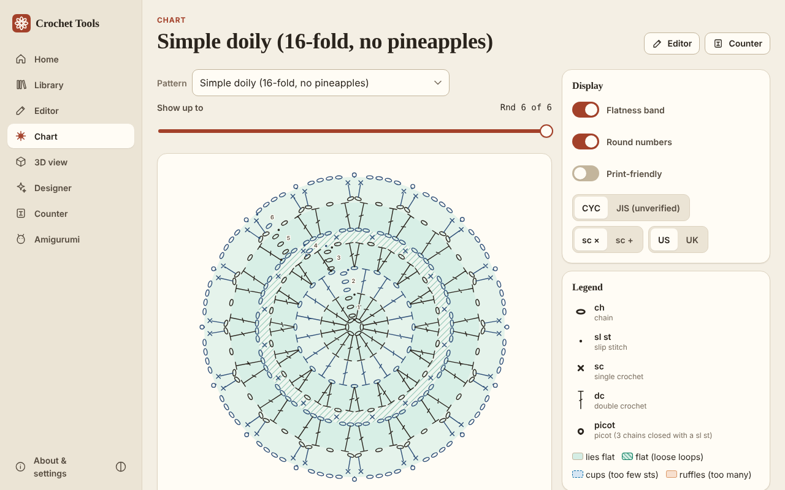
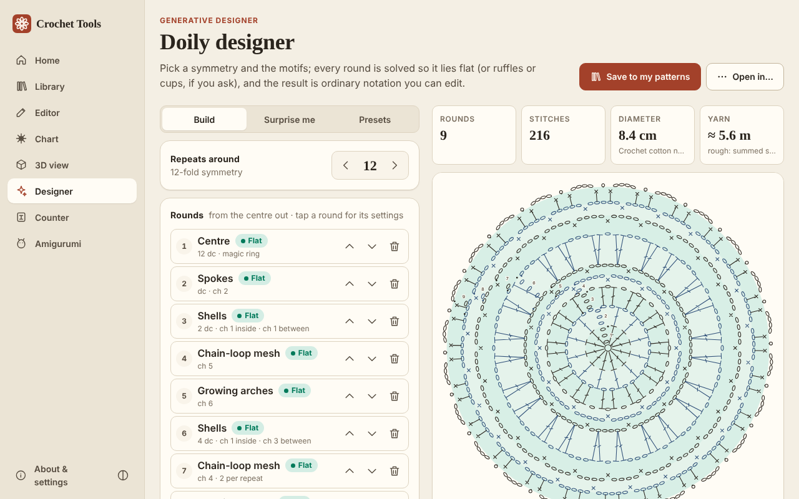
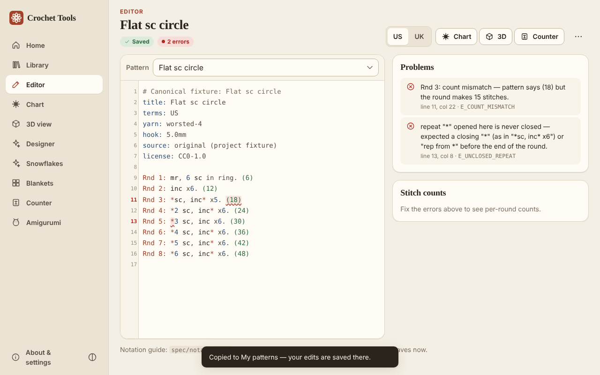
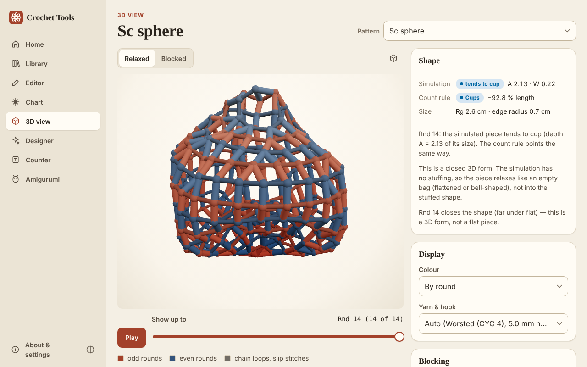
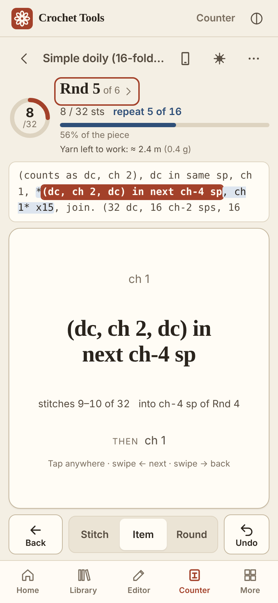
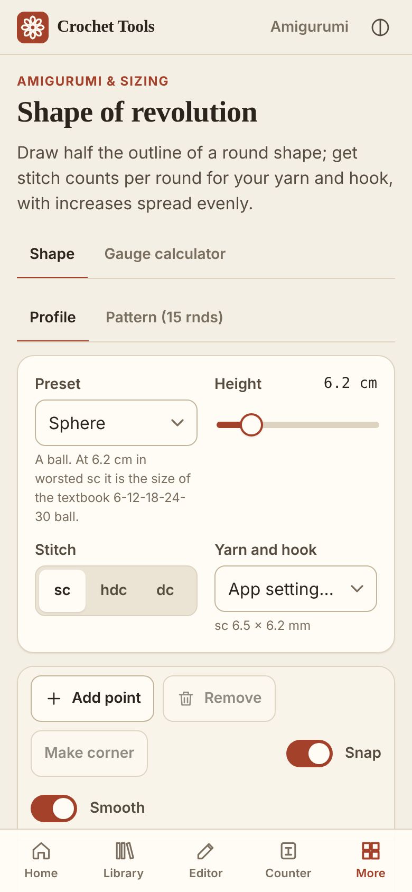
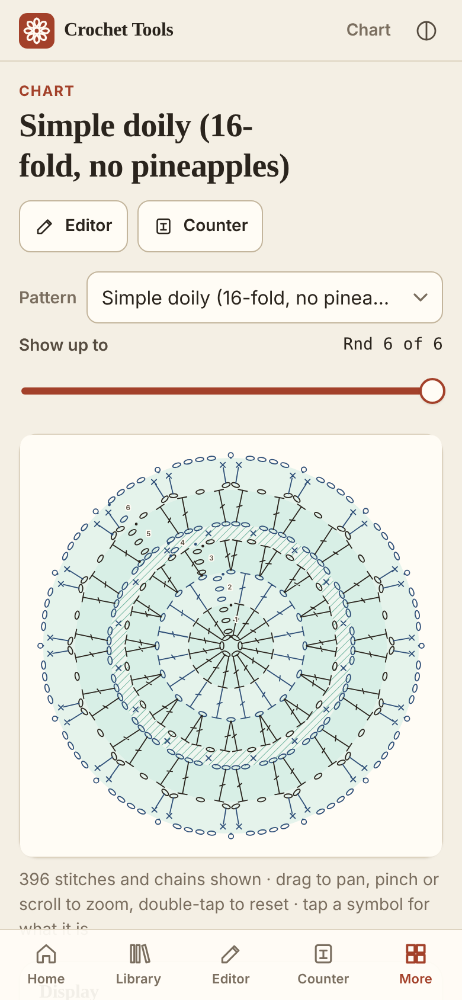

# Crochet Tools

Software tools for crochet — lace and doilies first, amigurumi next — all built on one shared
representation, the **stitch graph**: nodes are stitches, edges say what each stitch is worked
into (a stitch, a chain space, a ring) and what comes next along the yarn. Every tool is a view of
that graph.

| | |
|---|---|
|  |  |
| Symbol chart with the flatness band | Generative doily designer |
|  |  |
| Notation editor with positioned diagnostics | Physics view (sphere fixture) |

  

More screenshots of every feature, desktop and phone: [`docs/screenshots/`](docs/screenshots).

## Run it

```bash
npm install && npm run dev     # the app, at the localhost URL Vite prints
make lab                       # Python env (uv), lab tests, notebooks → lab/reports/*.html
```

Requirements: Node 22+, and [uv](https://docs.astral.sh/uv/) for the lab. Other entry points:
`make test` (everything), `cd app && npm test`, `cd lab && uv run pytest -q`,
`cd app && npm run check -- path/to/pattern.cro` (command-line validator),
`cd app && npm run build && npm run screenshots` (regenerate `docs/screenshots/`),
`make lab-check` (reports are byte-reproducible), `cd app && npm run sim:corpus` (sim vs count rule on the corpus).

**Without running anything:** the lab results are pre-rendered in
[`lab/reports/`](lab/reports) (open `index.html`). The app deploys to **GitHub Pages** from `main`
via `.github/workflows/pages.yml`. **This work is on the branch `claude/new-session-1jt15o`, so
nothing is published until it is merged to `main`.** Enable Pages once under *Settings → Pages → Source: GitHub
Actions*; after that every push to `main` publishes the app, which you can open on a phone and
"Add to Home Screen" (it is an offline-capable PWA).

## What exists (Phase 1)

### app/ — TypeScript, React, Vite, PWA; no backend, data stays on the device

| Feature | Route | Status |
|---|---|---|
| **Gallery** linking every feature, preloaded with fixtures and corpus | `#/` | works |
| **Editor**: notation → live validation with line/column diagnostics, stitch-count table, US ⇄ UK conversion | `#/editor` | works |
| **Chart**: radial symbol chart (CYC-style symbols generated from stitch structure), pan/zoom, SVG/PNG export | `#/chart` | works; weak on cornered motifs and closing rounds of spheres |
| **Flatness checker**: per-round flat / cup / ruffle with "about N stitches over flat", as a colour band on the chart | in Chart, Designer | works; analytic approximation (see below) |
| **3D view**: spring simulation of the graph, round slider, relaxed vs blocked | `#/sim` | works; approximate physics, nominal parameters |
| **Doily designer**: symmetry order + motif stack or seeded "surprise me"; every round solved for flatness; output is ordinary notation | `#/designer` | works |
| **Row counter**: phone-first, steps through the graph by stitch / item / round, wake lock, persists locally | `#/counter` | works |
| **Amigurumi**: profile curve → surface-of-revolution pattern with evenly spread, staggered increases | `#/amigurumi` | works (stretch goal) |
| **Gauge calculator**: rectangle, circle, tube, hat, gauge conversion | `#/amigurumi?tab=gauge` | works (stretch goal) |
| **Library**: local patterns (IndexedDB), import/export `.cro` and graph JSON | `#/library` | works |

The core is pure TypeScript in `app/src/core/` (no DOM): `notation` (lexer, recursive-descent
parser, printer), `graph` (compiler, validator, queries), `flatness`, `chart`, `sim`, `generate`,
`counter`, `amigurumi`.

### lab/ — Python research side

* `crolab.sim` — reference simulator: spring network over the stitch graph, grown round by round,
  minimised with L-BFGS. Reproduces all seven fixtures.
* `crolab.curvature` — Gauss–Bonnet per round from rest lengths; angle deficit on the simulated
  surface (sphere ≈ 4π, flat ≈ 0, hyperbolic strongly negative).
* `crolab.flatness` — mirror of the app's analytic check.
* `crolab.fitting` — fit `stitch_params.json` from swatch measurements (width/height; stiffness is a stub).
* `crolab.swatch` — photo of a swatch on a printed ArUco sheet → rectified image → gauge; printable
  sheets in [`lab/swatch/`](lab/swatch); the by-hand protocol is
  [`lab/swatch/PROTOCOL.md`](lab/swatch/PROTOCOL.md).
* Reports: [`lab/reports/index.html`](lab/reports/index.html).

### spec/ — the contracts between the two sides

Notation grammar, stitch vocabulary, graph JSON Schema, the physics model, the flatness rule,
`stitch_params.json`, and seven canonical fixtures with expected stitch counts and shape class.
CI checks that the compiler hits the counts, that both simulators classify every fixture as
expected, that the app sim builds the identical spring network and matches the lab's metrics, and
that compiled fixture graphs are not stale. Start at [`spec/README.md`](spec/README.md).

### data/ and docs/

* [`data/corpus/`](data/corpus): 16 **original, CC0** lace patterns written for this project
  (14 flat designs, plus one that ruffles and one that cups on purpose), all listed in
  [`data/MANIFEST.csv`](data/MANIFEST.csv).
* [`docs/architecture.md`](docs/architecture.md), [`docs/decisions.md`](docs/decisions.md),
  [`docs/literature_review.md`](docs/literature_review.md), [`docs/roadmap.md`](docs/roadmap.md)
  (Phases 2–5), [`docs/review.md`](docs/review.md) (independent review of this build: 0 blockers,
  6 majors, 18 minors — the fixable ones were fixed afterwards, the rest are listed below).

## The notation, in one example

```
title: Simple doily
terms: US
Rnd 1: ch 6, join to form ring, ch 3 (counts as dc), 15 dc in ring, join. (16)
Rnd 2: ch 4 (counts as dc, ch 1), *dc in next st, ch 1* x15, join. (16 dc, 16 ch-1 sps)
Rnd 3: sl st in next ch-1 sp, ch 3 (counts as dc), dc in same sp, ch 1, *2 dc in next ch-1 sp, ch 1* x15, join. (32 dc, 16 ch-1 sps)
```

Errors come back in crocheter's terms with exact positions, e.g.
`Rnd 3, line 5 col 9: count mismatch — pattern says (18) but the round makes 15 stitches.`
Full grammar: [`spec/notation.md`](spec/notation.md).

## Honest status: what is approximate, stubbed or missing

**Not done**

* **The public-domain vintage corpus (10+ transcribed doilies) does not exist.** The build
  environment's network policy blocked Project Gutenberg and the Internet Archive, and patterns
  were deliberately not reconstructed from memory. The original CC0 patterns stand in as test
  cases. `data/README.md` section B has the exact procedure to gather the vintage corpus later.
* **No real swatch has been measured.** `spec/stitch_params.json` holds *nominal* values chosen so
  that the textbook flat circles (6 / 8 / 12 increases per round for sc / hdc / dc) are flat. Every
  size in mm or cm, and every flatness verdict near the threshold, inherits that. The swatch photo
  tool is validated on **synthetic photos only**.
* Literature review: 53 sources checked through search metadata; DOIs were not resolved live
  (publisher sites were blocked). Items that could not be confirmed are listed at the end of the
  review, including whether JIS L 0201 covers crochet — so the chart's "JIS" symbol set is marked
  unverified.

**Where the two shape checks disagree** (found by the independent review, `docs/review.md` R1–R4)

* The **3D view is a tendency, not a verdict.** On the 16 corpus patterns it agrees with the
  count rule on 12 ([`docs/sim_corpus_report.md`](docs/sim_corpus_report.md)); it calls three
  designs the count rule passes as flat "cup" or "ruffle", and it calls the deliberately ruffling
  teaching doily a cup. The spring network resists stretching far more than bending, so it reacts
  to mismatches of a few percent, while the count rule tolerates 10%. The flat/non-flat threshold
  (`tau_flat` = 0.25) was tuned on the seven fixtures. The UI now says all of this next to the result.
* The **lace flatness check is lenient by construction**: chain loops can take up slack, so a
  round can be "flat" only if its loops sag. Such rounds are now hatched on the chart and labelled
  "flat (loose loops)" — and most lace rounds in the corpus carry that label. Treat a hatched
  round as "probably fine after blocking", not as a guarantee.
* What ties the two simulators together is that they build the identical spring network (checked
  spring by spring in CI); agreement of the final shape numbers on the sphere and the hyperbolic
  plane is fragile, because those shapes have several stable states.

**Approximate**

* *Flatness check*: treats every round as a circle and uses a mean stitch height per round. Square
  and hexagonal motifs, scalloped rounds and tall leaning stitches are outside its assumptions.
  Chain loops are treated as compliant, so the model will accept very long loops as "flat".
* *Physics*: stitch-level springs, no self-collision (strong ruffles pass through themselves), no
  gravity, no stuffing — the sphere fixture relaxes like an empty bag, not a ball. The network resists stretching far more than bending, so the flat/non-flat
  threshold (`tau_flat`) was tuned on the fixtures — see `docs/decisions.md` 13–14 and
  `lab/SPEC_NOTES.md`. Read the 3D view as "which way will this go", not as a rendering.
* *Blocking* is a boundary condition (pin the edge flat and stretched), not a change in the yarn.
* *Chart*: a diagram, not a scale drawing; rounds are pushed apart for legibility.
* *Amigurumi*: surfaces of revolution only; poles come out slightly flat; yarn estimates are rules of thumb.
* *Designer*: 14 motifs; at very high symmetry orders a scalloped edge may not fit a repeat.

**Notation gaps** (planned for v0.2 — `data/corpus/NOTATION_FEEDBACK.md`): working into earlier
rounds, a picot or a ring's individual chains as targets, stitches above dtr, colour changes,
joining motifs. After a join, `next st` starts at the stitch the join went into, which is not how
every crocheter reads "sl st in next st" (decision 15).

**Undecided**: the code has **no licence** yet (the corpus is CC0) — that is the owner's call
(decision 21). Until one is added, others cannot legally reuse the code.

**Stubbed**: stiffness fitting (needs load tests); stitch-level geometry from photos (experimental
lattice overlay only).

## Repository layout

```
spec/   notation, vocabulary, graph schema, physics + flatness rules, stitch_params.json, fixtures
app/    TypeScript web app (core/ is framework-free; features/ are the pages)
lab/    Python: sim, curvature, fitting, swatch analysis, notebooks, reports
data/   pattern corpus + MANIFEST.csv (provenance and licence for every file)
docs/   architecture, decisions, literature review, roadmap, review, screenshots
```
